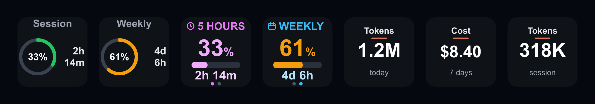

# Claude Usage — Stream Deck plugin

Stream Deck keys that show your **live Claude usage limits** and your **local
token / cost totals**. One configurable action — drop it on as many keys as you
like and pick a metric per key. Tap any key to force a refresh.

## What it shows

Place the action on several keys, each set to a different metric, to see them all
at once. Two families:

| Metric | Family | Source | Shown as |
| --- | --- | --- | --- |
| **Session (5h)** | Limit (live) | `oauth/usage` endpoint (same as Claude Code's `/usage`) | big % + ring gauge + reset countdown |
| **Weekly (7d)** | Limit (live) | same endpoint | big % + ring gauge + reset countdown |
| **Carousel** | Limit (live) | same endpoint | one key rotating through the faces you pick, in the order you set: the 5-hour, weekly and per-model windows (big %, progress bar, reset countdown, page dots) plus an optional picture-only **Badge** face — auto-rotates on a timer and/or switches on key press |
| **Model weekly (7d)** | Limit (live) | same endpoint (`limits[]`, `weekly_scoped`) | the per-model weekly cap some plans report; `--` on plans without one |
| **Burn rate** | Limit (live) | same endpoint, measured across polls | `%/h` on the 5h window + `full ~2h 10m` projection; `--` while idle |
| **Tokens** | Local logs | Claude Code JSONL transcripts on disk | big value (e.g. `1.2M`) + `today` / `7 days` / `session` |
| **Cost** | Local logs | Claude Code JSONL transcripts on disk | big value (e.g. `$8.40`) + `today` / `7 days` / `session` |
| **Tokens / Cost — 7-day chart** | Local logs + history | daily totals persisted in `~/.claude-usage/` (survive Claude Code pruning old transcripts) | today's value + a 7-bar week sparkline |

Live limits are color-coded green → amber → red, and a key **flashes once**
when a limit climbs past the Red threshold (re-armed when the window resets;
toggle per key). Updates run every 60s, and **tapping any key forces a refresh
now**.

On a **Stream Deck +**, the separate **Usage Dial** action puts a metric on the
touch strip: turn the dial to cycle metrics, press it (or tap the strip) to
force a refresh.

On a **Stream Deck Neo**, the **Usage Infobar** action puts the carousel on the
infobar under the keys — the same faces, order, timing, labels and colors as a
carousel key, laid out for the 232×50 strip. Icon, bar, countdown and page dots
can each be switched off. In place of the badge, the infobar has a **Summary**
face that lays the windows you tick (5-hour, weekly, model) side by side, each
with its % and bar, plus the time until reset when one or two are ticked. The
infobar takes no input, so a window crossing Red jumps to its face for one
interval instead of flashing.

Every poll also writes `~/.claude-usage/stats.json` — all profiles' live
limits, token/cost totals and burn rate in one machine-readable file, for OBS
overlays and scripts.

## Requirements

**To run:** the official [Elgato Stream Deck app](https://www.elgato.com/downloads)
**7.6 or newer** — it ships the Node runtime the plugin uses, so you do **not**
need Node.js installed separately. Runs on **Windows 10+** and **macOS 12+**, and
on both **Pro and Max** (metrics a plan doesn't report show `--`).

> **Log in to Claude Code at least once** on this machine first, so the token
> exists. The plugin reads it from `%USERPROFILE%\.claude\.credentials.json` on
> Windows, or the **login Keychain** (`Claude Code-credentials`) on macOS, and
> never sends it anywhere except Anthropic's own usage endpoint. Token/cost
> metrics additionally read the local transcripts under `~/.claude/projects/`.

> **Linux:** not supported for running. There is no official Stream Deck app for
> Linux, so the `.streamDeckPlugin` can't be installed there — but the data layer
> is plain Node and works on Linux (token from `~/.claude/.credentials.json`,
> logs from `~/.claude/projects/`), so the [verify command](TROUBLESHOOTING.md#verify-the-data-layer-first) and the source
> build both run fine on Linux.

**To build from source:** [Node.js 20+](https://nodejs.org) (any OS).

## Install

**From the [Elgato Marketplace](https://marketplace.elgato.com/product/ai-coding-usage-meter-f4aa1012-a57b-4a02-9b90-a37004678ee7)** — open the link and click **Get**; it installs straight into the Stream Deck app. Easiest path, and you get updates automatically.

Or install the packaged file manually:

1. **Stream Deck app 7.6+** installed (see [Requirements](#requirements)).
2. Download `com.saeedkolivand.claude-usage.streamDeckPlugin` from the
   [latest release](https://github.com/saeedkolivand/claude-usage-streamdeck-plugin/releases/latest)
   and double-click it → **Install**.
3. In Stream Deck, open the **AI Coding Usage Meter** category in the actions list
   and drag **Usage Meter** onto a key.
4. Select the key and pick a **Metric** in its settings (see [Configuration](CONFIGURATION.md)).
   Repeat on more keys for the others.

That's it. Keys populate within a second or two of being placed.

## More

- [Configuration](CONFIGURATION.md): every key setting, and running several Claude accounts side by side.
- [Troubleshooting](TROUBLESHOOTING.md): test the usage endpoint by hand, and what `open Claude`, `offline` and `--` mean.
- [Contributing](CONTRIBUTING.md): building from source, project layout, adding a metric.

## License

MIT.
